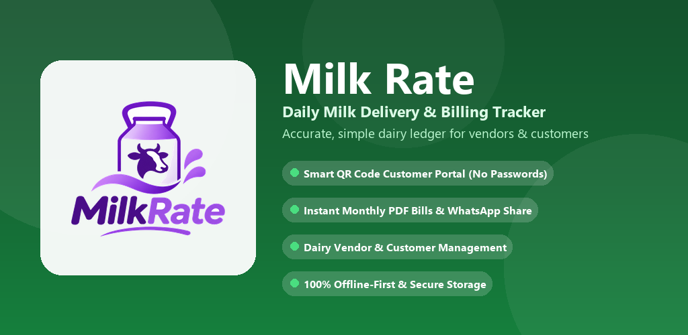
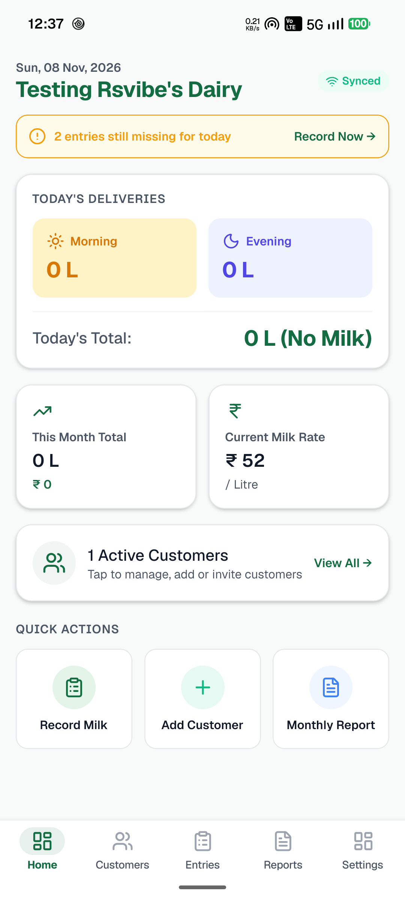
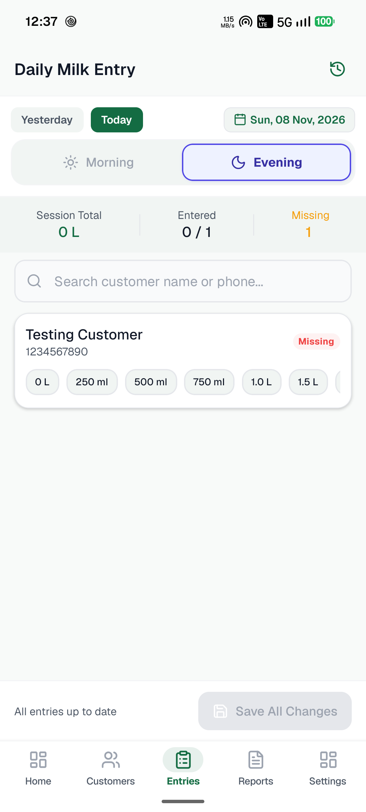
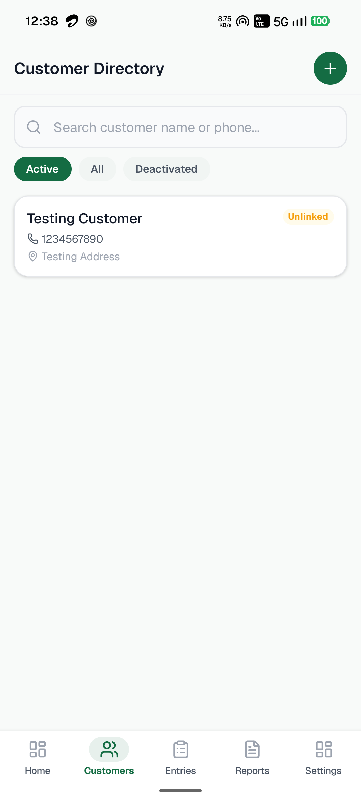
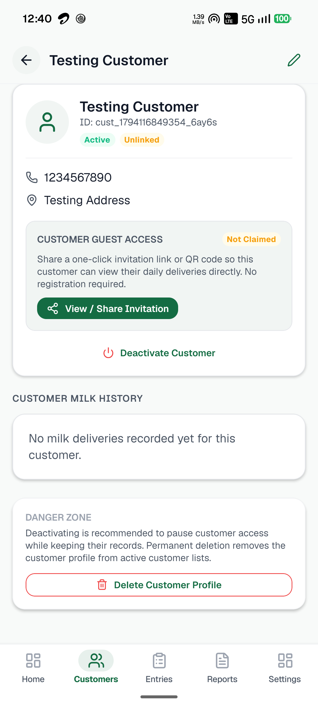
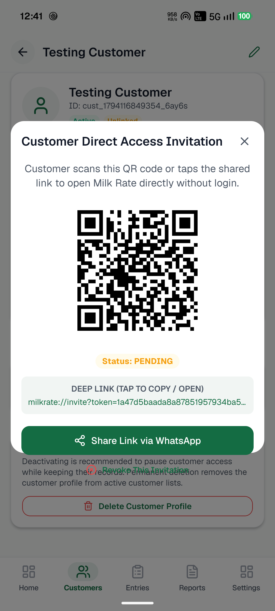
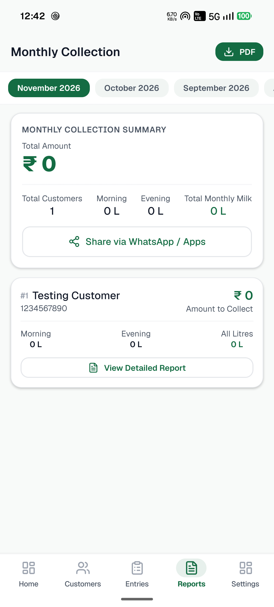
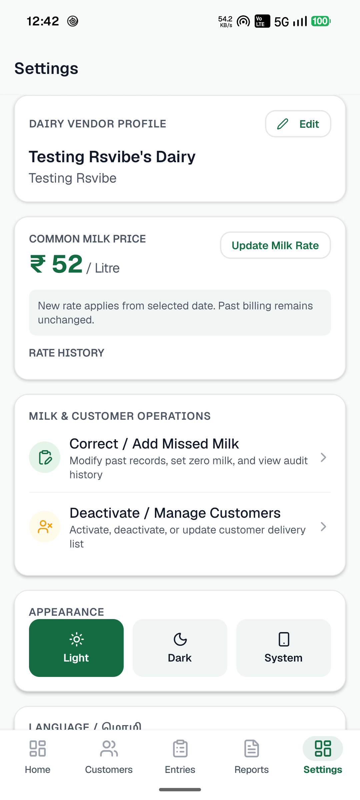

<p align="center">
  
</p>

<p align="center">
  
</p>

<h1 align="center">Milk Rate &bull; மில்க் ரேட்</h1>

<p align="center">
  <strong>Production-grade, offline-first mobile dairy management and billing platform built for milk vendors and households.</strong>
</p>

<p align="center">
  <a href="https://expo.dev"></a>
  <a href="https://reactnative.dev"></a>
  <a href="https://www.typescriptlang.org"></a>
  <a href="https://firebase.google.com"></a>
  <a href="https://www.android.com"></a>
  
  
</p>

<p align="center">
  <a href="https://s-g-rathenesh.github.io/Milk-Rate/privacy-policy.html"><strong>🌐 Live Privacy Policy</strong></a> &nbsp;&bull;&nbsp;
  <a href="https://s-g-rathenesh.github.io/Milk-Rate/delete-account.html"><strong>🗑️ Account Deletion Request</strong></a>
</p>

---

## 📖 Overview

**Milk Rate** is an offline-first Android application designed for Indian dairy sellers, independent milk vendors, and household consumers. It eliminates paper notebooks and manual diary calculations by replacing them with a secure, instant, and tamper-proof digital ledger.

The app is built around two isolated user roles:
1. **👨‍🌾 Milk Vendors (Sellers):** Manage customers, record daily morning and evening delivery volumes with quick chips, configure historical price rates per litre, and generate branded monthly PDF collection sheets with one-tap WhatsApp sharing.
2. **🥛 Household Consumers (Customers):** View an isolated, read-only delivery calendar showing exact daily morning/evening milk quantities, monthly consumption totals, and calculated bills with zero passwords required.

---

## 📱 App Screenshots

### Vendor Operations & Daily Accounting

| 1. Dashboard | 2. Daily Milk Entry | 3. Customer Directory | 4. Customer Profile |
|:---:|:---:|:---:|:---:|
|  |  |  |  |
| *Vendor overview, today's deliveries & quick actions* | *Morning & Evening sessions with quick quantity chips* | *Active/Deactivated customer ledger with rates* | *Customer rate configuration & invite management* |

<br/>

### Sharing, Invoicing & Configuration

| 5. Zero-Login QR Invite | 6. Monthly PDF Reports | 7. Dairy Settings & Theme |
|:---:|:---:|:---:|
|  |  |  |
| *Expiring single-use QR code & deep link for WhatsApp sharing* | *Monthly delivery totals with client-side PDF export* | *Dairy profile, price per litre, and Light/Dark themes* |

---

## ✨ Key Highlights

- **⚡ 100% Offline-First Architecture:** Built with local SQLite storage (`expo-sqlite`) and Cloud Firestore offline persistence caching. The app functions continuously without an internet connection and syncs automatically when reconnected.
- **🔢 Strict Integer-Millilitre Math:** All milk quantities are stored as integers in millilitres (`500 ml`, `1000 ml`), completely eliminating IEEE 754 floating-point rounding errors across delivery totals and billing.
- **📅 Historical Rate Immutability:** Changing the current price per litre applies only to deliveries on or after the effective date. Past entries and generated monthly bills preserve their original historical rate.
- **📲 Zero-Password Customer QR Login:** Customers connect without remembering passwords or receiving SMS OTPs. Scanning a single-use vendor invitation QR code establishes an anonymous, cryptographic guest session linked to their customer profile.
- **📄 Client-Side PDF Invoices:** High-speed on-device PDF engine (`expo-print`) produces formatted customer monthly collection sheets with dairy branding, downloadable or shareable directly to WhatsApp via `expo-sharing`.
- **🌐 Full Bilingual Support:** Seamless real-time switching between native **English** and **Tamil (தமிழ்)** across all screens, receipts, and reports.
- **🎨 Modern Fintech Design System:** Purpose-built UI supporting system, light, and dark modes with emerald accents (`#15803D`), accessible contrast, and smooth micro-interactions.

---

## 🛠️ Technology Stack

| Domain | Technology / Library | Version | Purpose |
|:---|:---|:---:|:---|
| **Core Framework** | [React Native](https://reactnative.dev) | `0.88.1` | Native Android mobile runtime |
| **Tooling & Engine** | [Expo SDK](https://expo.dev) | `58.0.23` | Modern managed workflow and native modules |
| **Navigation** | [Expo Router](https://docs.expo.dev/router/introduction/) | `58.0.30` | Type-safe file-based stack and tab navigators |
| **Language** | [TypeScript](https://www.typescriptlang.org) | `6.0.3` | End-to-end strict type safety |
| **Backend & Sync** | [Google Cloud Firestore](https://firebase.google.com/docs/firestore) | `13.2.0` | Cloud database with offline persistence |
| **Authentication** | [Google Sign-In](https://github.com/react-native-google-signin/google-signin) + Firebase Auth | `17.0.0` | OAuth 2.0 seller login & anonymous customer tokens |
| **State Management** | [Zustand](https://github.com/pmndrs/zustand) | `5.1.0` | Lightweight reactive stores with AsyncStorage persistence |
| **Forms & Validation** | [React Hook Form](https://react-hook-form.com) + [Zod](https://zod.dev) | `7.91` / `4.6` | Schema-driven form handling and validation |
| **PDF Generation** | [Expo Print](https://docs.expo.dev/versions/latest/sdk/print/) | `58.0.8` | Client-side HTML-to-PDF rendering engine |
| **Native Sharing** | [Expo Sharing](https://docs.expo.dev/versions/latest/sdk/sharing/) | `58.0.22` | Direct Android share sheet (WhatsApp, Print, Drive) |
| **QR Code Engine** | `react-native-qrcode-svg` + `react-native-svg` | `6.3` / `15.16` | Vector QR code rendering for customer invitations |
| **Icons** | [Lucide React Native](https://lucide.dev) | `1.70.0` | Crisp vector iconography |
| **Testing** | [Jest](https://jestjs.io) + `ts-jest` | `30.5.2` | Comprehensive automated test suite (87/87 tests) |

---

## 📂 Project Architecture

```text
Milk-Rate/
├── assets/
│   ├── images/                        # Logos, icons, banners & adaptive launcher assets
│   │   ├── banner.png                 # Repository & store banner (1024x500)
│   │   ├── logo-transparent.png       # Transparent app logo (512x512)
│   │   └── icon.png                   # App icon
│   └── screenshots/                   # Authentic physical device screenshots (1080x2392)
│       ├── 01_dashboard.png           # Vendor Home Dashboard
│       ├── 02_daily_entries.png       # Daily Milk Entry Screen
│       ├── 03_customer_directory.png  # Customer Register
│       ├── 04_customer_detail.png     # Customer Profile & Rates
│       ├── 05_qr_invitation.png       # Customer QR Invitation Modal
│       ├── 06_monthly_reports.png     # Monthly Billing & Invoices
│       └── 07_settings.png            # Dairy Profile & Settings
├── docs/                              # GitHub Pages documentation
│   ├── delete-account.html            # Google Play compliant Account Deletion page
│   ├── index.html                     # Docs redirect
│   └── privacy-policy.html            # Official Privacy Policy
├── firebase/
│   ├── firestore.rules                # Cloud Firestore security rules (role isolation & anti-tamper)
│   └── firestore.indexes.json         # Composite database indexes
├── google-play/                       # Google Play Store submission package
│   ├── app_icon_512x512.png           # 32-bit PNG Google Play icon
│   ├── feature_graphic_1024x500.png   # 1024x500 Feature Graphic
│   ├── screenshots/                   # Store listing screenshots
│   ├── store_listing_content.txt      # Character-counted English & Tamil metadata
│   └── README.md                      # Play Console submission guide
├── src/
│   ├── app/                           # Expo Router routes
│   │   ├── (auth)/                    # Seller login & dairy registration routes
│   │   ├── (customer)/                # Customer read-only tabs (Home, History, Summary, Profile)
│   │   ├── (seller)/                  # Vendor tabs (Home, Customers, Entries, Reports, Settings)
│   │   ├── index.tsx                  # Root welcome screen & QR scan entry
│   │   ├── invite.tsx                 # Deep link invitation resolver
│   │   └── _layout.tsx                # App root provider wrapper
│   ├── components/                    # Modular UI components
│   ├── localization/                  # English (`en.ts`) & Tamil (`ta.ts`) language dictionaries
│   ├── services/                      # Firebase config, Google Auth, and PDF report generator
│   ├── store/                         # Zustand state slices
│   ├── theme/                         # Light & Dark design tokens, colors, typography
│   └── utils/                         # Pure math, Indian Rupee formatting, date helpers
├── tests/                             # 13 test suites / 87 automated unit & integration tests
├── app.json                           # Expo app configuration
├── package.json
└── tsconfig.json
```

---

## 🔒 Security & Data Isolation Architecture

Cloud Firestore security rules (`firebase/firestore.rules`) enforce enterprise-grade multi-tenant data boundaries:

1. **Vendor Isolation:** Sellers can only query and modify their own customers, delivery entries, rate configurations, and audit records (`request.auth.uid == sellerId`).
2. **Customer Read-Only Containment:** Anonymous customer sessions are restricted exclusively to their assigned customer document (`resource.data.linkedUserId == request.auth.uid`). Customers have zero write or delete permissions.
3. **Cryptographic Single-Use Invitations:** Invitations utilize 128-bit unguessable tokens, enforce 7-day expiration windows, and are atomically bound to a single device upon redemption.
4. **Append-Only Immutability:** Rate changes never modify past delivery entries. Historical audit logs track adjustments transparently.

---

## 🚀 Development & Testing

### 1. Prerequisites
- **Node.js:** `v20.x` or higher
- **Package Manager:** `npm` or `bun`
- **Expo CLI:** Bundled with `npx expo`

### 2. Setup
```bash
# Clone the repository
git clone https://github.com/S-G-Rathenesh/Milk-Rate.git
cd Milk-Rate

# Install SDK-compatible dependencies
npm install
```

### 3. Run Automated Tests
```bash
npm test
```
*Runs all 13 test suites and 87 unit/integration tests verifying calculation accuracy, currency formatting, rate immutability, customer isolation, and guest authentication.*

### 4. Code Quality & Health Checks
```bash
# Typecheck
npx tsc --noEmit

# Lint
npx expo lint

# Expo Doctor health scan
npx expo-doctor
```

### 5. Launch the Application
```bash
# Start Expo development server
npx expo start

# Run directly on connected Android device / emulator
npx expo run:android
```

---

## 📄 Compliance & Policies

- **Privacy Policy:** [https://s-g-rathenesh.github.io/Milk-Rate/privacy-policy.html](https://s-g-rathenesh.github.io/Milk-Rate/privacy-policy.html)
- **Account Deletion Request:** [https://s-g-rathenesh.github.io/Milk-Rate/delete-account.html](https://s-g-rathenesh.github.io/Milk-Rate/delete-account.html)
- **Developer Contact:** `ratheneshsg@gmail.com`

---

## 📜 License

This project is licensed under the [MIT License](LICENSE).
